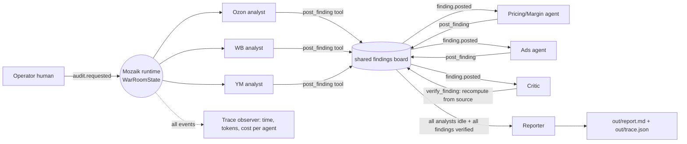

# Seller War Room — plan (NTP Novi Sad Hackathon, Freestyle track)

**One line:** a team of concurrent Mozaik agents audits a marketplace seller (Ozon + Wildberries + Yandex Market) in parallel
and produces a verified report *"where the shop loses money and what to fix"*, with a per-agent time/cost trace.

Status: PREP only (scaffold, synthetic data, concurrency smoke test). Core agents/report are built during the hackathon
(30.10 10:00 CET → 31.10 20:00 CET).

## Scoring map (Freestyle)

| Criterion | Pts | How we hit it |
|---|---|---|
| Usefulness / originality | 30 | Real seller pain (fees, returns, ads, storage eat margin across 3 marketplaces). Output = ranked RUB losses + concrete fixes. Critic makes numbers trustworthy. |
| Mozaik usage (parallelism, shared state) | 30 | 6+ participants on one runtime; analysts fan out from one `audit.requested` event; all write to `WarRoomState.board`; cross-agents and critic react to `finding.posted` events (reaction, not orchestration); interception gate on `post_finding`. |
| Runs per README | 25 | `npm i && npm run demo` works with **no key** (mock runner, deterministic). `WARROOM_MODE=live` with `OPENROUTER_API_KEY` for real LLM. `npm test` checks planted issues are found. |
| README | 10 | What / architecture diagram (mermaid) / how to run / sample output / trace screenshot. |

## Architecture

### Participants
| Participant | Kind | Trigger | Tools | Writes |
|---|---|---|---|---|
| Operator | human | start | – | `audit.requested` |
| Ozon / WB / YM analyst | agent ×3, **run concurrently** | `audit.requested` | `get_sales_summary(mp)`, `get_deductions(mp)`, `get_stock(mp)`, `get_ads(mp)`, `post_finding` | findings (status `proposed`) |
| Pricing/Margin agent | agent | `finding.posted` kind=margin/returns, or analysts done | `unit_economics(mp, sku)`, `compare_prices(sku)` across 3 MPs, `post_finding` | cross-MP findings (e.g. "same SKU profitable on YM, loss on Ozon → raise Ozon price to X") |
| Ads agent | agent | `finding.posted` kind=ads, or analysts done | `ads_summary(mp)` (DRR, spend on OOS SKUs), `post_finding` | ad findings |
| Critic | agent | every `finding.posted` | `verify_number(source, query)` — deterministic recompute from raw JSON | sets finding `verified` / `rejected(reason)`; rejected → event back to author (one retry) |
| Reporter | agent | `board.settled` | `read_board` | `out/report.md` (RU + EN), ranked by RUB/month |
| Trace observer | human (observer) | all events | – | `out/trace.json`, live console table |

### Shared state (`WarRoomState extends RuntimeState`)
- `shop` (loaded synthetic export), `board: Finding[]` with `{id, author, marketplace, sku, kind, lossRub, evidence:{tool, args, value}, fix, status}`.
- `agents: Map<id, {status, startedAt, endedAt, tokensIn, tokensOut, costUsd, toolCalls}>`.
- Settlement rule: `board.settled` fires when all analysts/cross agents are idle and no finding is `proposed`.

### Guarantees ("critic verifies every number")
- Agents never compute money in the LLM: every RUB number must come from a tool result (`evidence`). `post_finding` rejects findings without `evidence`.
- Critic recomputes `evidence` with the deterministic engine (`src/engine/*.ts`, pure functions over the JSON) and compares within ±1 %. Mismatch → `rejected`.
- `InterceptionHandler` on `function_call` for `post_finding`: dedup (same mp+sku+kind) and schema check before it runs — shows off Mozaik interception.

### Deterministic engine (unit economics, ideas from our panel, rewritten, no client data)
Per SKU per marketplace for the 30-day period:
- `revenue = Σ price (sales)`, `fees = commission + acquiring + logistics + returnLogistics`, `storage`, `penalties`, `ads`.
- `profitPerUnit = price − commission − acquiring − logistics − cogs − tax(price) − returnLogistics·(1−buyout)/buyout`.
- Loss rules (each → finding with RUB/month): margin below target (`targetMarginPerUnit`), negative unit profit,
  DRR > target (`spend / attributedRevenue`), ad spend on SKU with stock 0, buyout < 50 %, storage for stock > 90 days of sales
  (`days of cover = units / avgOrdersPerDay`), penalties.
- Fix suggestions: min price for target margin `(cogs + logistics + target + returnCost) / (1 − commission − acquiring − tax)`, pause/cut bids, liquidate overstock, check packaging (returns), ship on time.

### Trace / time / cost per agent
Trace observer listens to `inference.started/completed` (tokenUsage) and `function_call.*`, computes wall time per agent,
tokens and cost (OpenRouter price table per model, cached in `src/pricing.ts`). Output: console table + `out/trace.json` +
Gantt-style timeline in the report proving parallel execution.

## Demo data (synthetic, `data/demo-shop/`)
Generated by `data/generate.ts` (seeded PRNG, reproducible). "Demo Tea House": 10 SKUs, 30 days, 3 marketplaces.
Files per MP: `operations.json` (sales/returns with fees), `deductions.json` (storage, penalties), `ads.json`, `stocks.json`, `prices.json`;
shared `costs.json`, `shop.json` (tax 6 %, target margin 80 ₽/unit, target DRR 10 %).
`planted-issues.json` = answer key (6 leaks) used by `npm test`:
1. Ozon: buckwheat honey 500 g priced 590 → loss after heavy logistics.
2. Ozon: matcha campaign ~450 ₽/day while stock = 0.
3. WB: glass teapot buyout ~38 % → return logistics.
4. WB: teapot ads DRR ≫ 10 %.
5. WB: gift set 2400 units in stock vs ~2/day → storage burn.
6. YM: 7 late-shipment penalties × 1500 ₽.
(Also natural: tea infuser on Ozon below target margin.)

## Hackathon timeline (MSK; CET +2h)
- Fri 12:00–15:00: engine + tools + `WarRoomState`, 3 analysts parallel (mock + live).
- Fri 15:00–20:00: critic + interception + cross agents, settlement, reporter.
- Fri 20:00–24:00: trace observer, cost table, `npm test` vs planted issues.
- Sat 10:00–16:00: README, diagram, screenshots, live run, short demo video; polish RU/EN report.
- Sat 17:00–19:00 (CET 17:00 demos optional) final checks; **submit before Sat 22:00 MSK**.

## Models / keys
- Mozaik picks provider by model name; keys from env (`OPENAI_API_KEY`, `ANTHROPIC_API_KEY`, `GEMINI_API_KEY`).
- **Primary: OpenRouter** via `OpenAIChatCompletions(undefined, {baseURL, apiKey})` custom `supportedModels` entry
  (see `src/models.ts`). Default model `google/gemini-2.5-flash` (~$0.30/$2.50 per 1M tokens). Tested live: tool calls work.
- Bundled `gemini-3.5-flash` with `GEMINI_API_KEY` **fails on tool calls** in @mozaik-ai/core 4.2.0
  (Gemini 400 "missing thought_signature") → avoid for agents with tools, or use via OpenRouter.
- Mock runner (default) = no key, deterministic; judges can run it.
- Telemetry: @mozaik-ai/cloud-sdk is disabled unless `MOZAIK_API_KEY` is set (we don't set it).

## Rules checklist
- [x] Mozaik (@mozaik-ai/core 4.2.0, TypeScript)
- [x] ≥2 agents concurrently with shared state — smoke test `npm run hello` passes (mock + live)
- [ ] core work during hackathon (git history shows prep commits before 30.10 10:00 CET; main code after)
- [ ] public GitHub repo + README (create at the hackathon, with the boss's go-ahead)
- [ ] submission form on the dashboard before 31.10 20:00 CET
