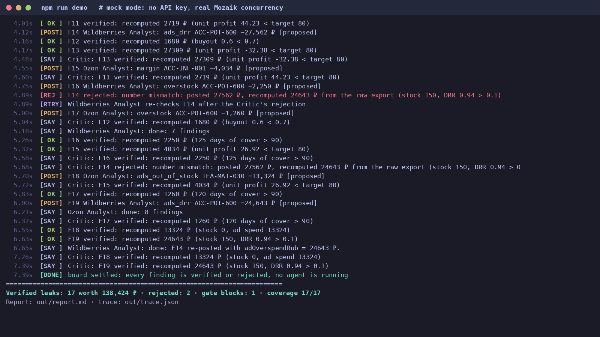
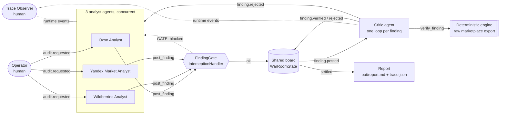

# Seller War Room 🚨

**Multi-agent audit of a marketplace seller's money leaks, built on [Mozaik](https://www.npmjs.com/package/@mozaik-ai/core) (`@mozaik-ai/core` 4.2).**

A seller on Ozon, Wildberries and Yandex Market loses money in a dozen quiet ways: prices below the target margin,
ads still running on out-of-stock items, ad spend far above the target DRR, piles of overstock paying storage, returns, late-shipment penalties.
Finding them means hours in three different seller dashboards every week.

Seller War Room opens a "war room" for the store: **three marketplace analysts audit at the same time**, every finding
lands on a **shared board**, and a **Critic agent re-computes every number** from the raw export before it reaches the report.
Wrong numbers are rejected and sent back to the analyst for one retry. Duplicate posts are blocked by an **interception gate**
before they reach the board. The result is a ranked list of verified leaks in ₽ with a concrete fix for each.

> **LLMs reason; numbers come from code.** Analysts decide *what* is a leak and *what to do*; every ₽ in the report is checked by a deterministic engine.



Demo videos (replays of real runs at real speed): [`docs/demo-mock.mp4`](docs/demo-mock.mp4) · [`docs/demo-live.mp4`](docs/demo-live.mp4)

## What it does (one run)

1. **Operator** (a Mozaik human participant) publishes `audit.requested`.
2. **Ozon / Wildberries / Yandex Market analysts** (3 Mozaik agents) react to the same event **concurrently**: each calls
   `get_marketplace_metrics` and posts findings with `post_finding` to the shared `WarRoomState.board`.
3. Every post publishes `finding.posted`. The **Critic** agent reacts to each one with its **own loop**, so several verifications run in
   parallel while the analysts are still working. It calls `verify_finding`, which re-computes the loss from the raw data:
   - match within 1 % → `finding.verified`
   - wrong number or not a leak under the rules → `finding.rejected` with the reason
4. On `finding.rejected` the author analyst starts a **retry loop** ("REJECTED by the Critic: … reason …") and may post one corrected finding.
5. A **FindingGate** `InterceptionHandler` sits in front of every `post_finding` call: schema check, unknown SKU, duplicates of what is
   already on the board, repeats of rejected findings. A blocked call never reaches the board; the agent gets a `GATE:` message instead.
6. A **Trace Observer** (human participant) listens to runtime events (`inference.completed`, `function_call.started`, `model.answer`) and tracks
   per-agent loops, tool calls, tokens, cost and a timeline. When every finding is verified or rejected and no loop is running, the board is **settled**.
7. A deterministic reporter writes `out/report.md` (ranked leaks, rejects, gate blocks, coverage vs. the engine, agent table, ASCII Gantt) and `out/trace.json`.

Nobody calls anybody: coordination happens only through Mozaik events and the shared runtime state.

## Architecture



| Mozaik feature | Where |
|---|---|
| `defineRuntime<WarRoomState>()`, custom `RuntimeState` as the shared board | `src/runtime.ts` |
| several agents + humans joined to one runtime, `SituationSpecification` handlers on custom events | `src/participants.ts` |
| concurrent `runLoop`s: 3 analysts at once, N parallel Critic loops (fresh `ModelContext` per loop) | `src/runtime.ts` `startLoop` |
| `InterceptionHandler` that blocks a function call and redirects to `message_received` | `FindingGate` in `src/participants.ts` |
| runtime events for observability (`inference.completed`, `function_call.started`, `model.answer`) | `makeObserver` |
| custom `InferenceRunner` (deterministic mock) / OpenRouter / bundled models | `src/models.ts` |

## How to run

Requires Node.js ≥ 20.

```bash
npm install
npm run demo          # mock mode: no API key, free, ~8 s
npm test              # end-to-end test of the mock run
```

Live mode with a real LLM (any OpenRouter model; default `google/gemini-2.5-flash`, ~$0.03 and ~15 s per run):

```bash
cp .env.example .env  # put OPENROUTER_API_KEY=... into .env
npm run demo:live
# or a bundled Mozaik model: WARROOM_MODE=live GEMINI_API_KEY=... WARROOM_MODEL=gemini-3.5-flash npm run demo
```

Output: the live event log in the terminal, `out/report.md`, `out/trace.json`.

**Mock mode** is not a recording: it is a scripted `InferenceRunner` with random 0.3–0.9 s latency that drives the *same* agents, tools, events,
gate and Critic through the real Mozaik runtime. It deliberately makes three typical LLM mistakes so the safety nets are visible:
a wrong field copied into a number (→ Critic rejects → analyst retries with the right one), a false-positive overstock (→ rejected → withdrawn),
and a duplicate post (→ blocked by the gate).

Other scripts: `npm run hello` (minimal concurrency smoke test), `npm run data` (regenerate the synthetic shop), `npm run typecheck`.

## Sample result

Mock run ([full report](docs/sample-report-mock.md)): **17 verified leaks worth 138 424 ₽**, 2 rejected by the Critic, 1 blocked by the gate, coverage 17/17, wall time 7.5 s.

```
Ozon Analyst           |██████████████████████████████████████████████████··········|
Wildberries Analyst    |██████████████████████████████████████▓▓▓▓███████████·······|
Yandex Market Analyst  |█████████████▓▓▓▓▓▓▓▓▓▓█····································|
Critic                 |······███▓▓▓▓▓▓▓▓▓▓▓▓▓▓▓▓▓▓▓▓▓▓▓▓▓▓▓▓▓▓▓▓▓▓▓▓▓▓▓▓▓▓▓▓▓▓▓▓▓▓█·|
                        0 ms                                                  7534 ms
```
(▓ = several loops of the same agent at once: the Critic verifies many findings in parallel.)

Live run with `google/gemini-2.5-flash` ([full report](docs/sample-report-live.md)): 15 verified leaks worth 134 494 ₽, 1 false positive
rejected by the Critic, 1 duplicate blocked, coverage 15/17 (the report honestly lists the two leaks the LLM missed), 11.4 s, about $0.027.

Top findings:

| Marketplace | SKU | Leak | Loss / 30 days | Fix |
|---|---|---|---:|---|
| Wildberries | Gift set 4 teas | overstock | 36 000 ₽ | 2400 units = 1200 days of sales: stop supplies, clearance promo |
| Ozon | Buckwheat honey 500 g | margin | 27 309 ₽ | raise price from ~590 ₽ to ≥ 750 ₽ (unit profit −32 ₽) |
| Wildberries | Glass teapot 600 ml | ads DRR | 24 643 ₽ | DRR 94 % vs 10 % target: cut bids |
| Ozon | Matcha 30 g | ads on out-of-stock | 13 324 ₽ | pause the campaign, stock is 0 |
| Yandex Market | store | penalties | 10 500 ₽ | 7 late shipments: earlier cut-off |

## Data

`data/demo-shop/` is a **synthetic** shop ("Demo Tea House", 10 SKUs × 3 marketplaces, 30 days): operations, deductions, ads, stocks, prices,
costs, plus `planted-issues.json` with 6 leaks planted on purpose. `npm test` checks that all of them are found and verified.
No real seller data is used. Point `WARROOM_DATA` at another folder with the same layout to audit other data.

## Project layout

```
src/engine.ts        deterministic unit economics + leak rules (the source of truth for every number)
src/runtime.ts       WarRoomState (shared board, stats) + Mozaik runtime + loop helpers
src/participants.ts  analysts, Critic, FindingGate, Trace Observer, Operator
src/models.ts        mock InferenceRunner / OpenRouter / bundled models
src/warroom.ts       wiring: join participants, publish audit.requested, wait until settled
src/report.ts        report.md + trace.json + ASCII Gantt
src/demo.ts          CLI entry
test/                end-to-end test (node:test)
tools/render_demo.py renders a run log into the PNG/MP4 in docs/
```

## Built during the NTP Novi Sad × JigJoy hackathon

Track: Freestyle. Core code written on 30–31 Oct 2026. MIT license.
